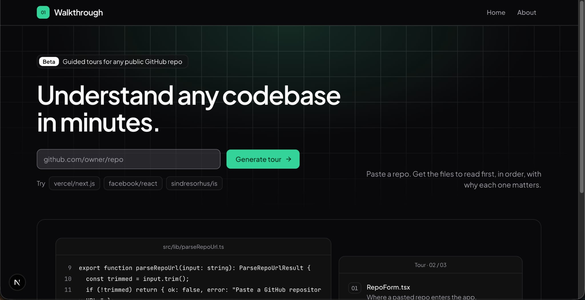
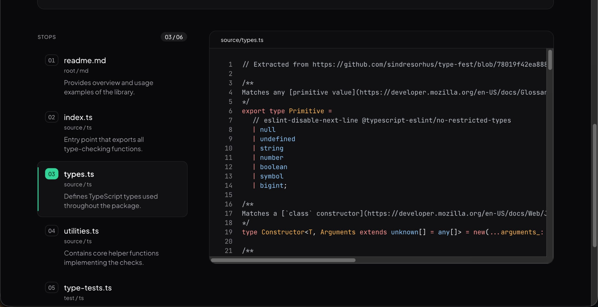

# Walkthrough

AI-generated guided tours of any public GitHub codebase.

Paste a GitHub repo and Walkthrough reads its file tree, picks the 5–8 files a newcomer should read first, puts them in reading order with one sentence on why each matters, and opens each one in a syntax-highlighted code panel next to the tour. Built as the capstone for the FlyRank AI Internship (Frontend AI Engineering track).

**Live:** <https://walkthrough-proj.vercel.app>

| Home | Tour |
| --- | --- |
|  |  |

## Why

- Groupmates inherit code they didn't write and don't know where to start.
- Project defenses ask "explain this part," and reading a repo cold is slow.
- READMEs say *what* a project is, rarely *where to start reading*.

## Features

- Paste a repo as `owner/repo` or a full GitHub URL, or click one of the example repos on the home page. Inline validation errors, announced to screen readers.
- Collapsible file tree of the repo's default branch, with `node_modules`, lockfiles and binaries filtered out (capped at 300 files).
- AI-picked tour of 5–8 files in reading order, each with a short reason. Steps stream in as the model writes them.
- Code panel: click a step, or any file in the tree, to open it highlighted on the server (Shiki, dark high-contrast theme). Step 1 opens automatically.
- Clear loading, streaming, error and retry states: offline, dropped connection, AI busy or timed out, repo not found, GitHub rate limit, empty repo, bad model output. A **Stop generating** button cancels a tour in progress. Full list in [docs/FAILURES.md](docs/FAILURES.md).
- Per-IP rate limits and request size caps on the API routes.
- `/health` page with the live GitHub API rate limit and whether a token is configured.
- Accessible: semantic HTML, keyboard navigation, visible focus, polite live-region status updates, animations off under `prefers-reduced-motion`. Lighthouse accessibility 100 on home and tour ([docs/AUDIT.md](docs/AUDIT.md)).

## How it works

1. **`getRepoTree`**: the tour route (`POST /api/tour`) forces the model to call this tool first. It fetches the default branch's file tree from the GitHub REST API, drops noise and returns up to 300 paths.
2. **`planTour`**: the model is then forced to call this tool with its picks. The tool drops any path that isn't in the fetched tree, so the UI only gets real files. Both steps stream to the browser with the Vercel AI SDK.
3. **Code panel**: when a step or file is selected, the browser calls `GET /api/file`, which fetches the file from GitHub and returns it highlighted with Shiki.

All AI and GitHub calls run on the server. File paths from GitHub are treated as untrusted input in the prompt.

## Stack

- Next.js 16 (App Router) + TypeScript (strict), React 19 with the React Compiler
- Tailwind CSS 4, shadcn/ui components on Base UI primitives, one dark theme (Plus Jakarta Sans, JetBrains Mono for code)
- Vercel AI SDK with Groq (`openai/gpt-oss-120b`, free tier). The provider, model and key name are constants at the top of `src/app/api/tour/route.ts`, so swapping providers is a small, local change.
- Zod for tool input and request validation
- Shiki for server-side syntax highlighting
- GitHub REST API for repo contents
- Vitest, Testing Library and axe-core for tests
- Deployed on Vercel

## Getting started

You'll need Node.js LTS and npm.

```bash
npm install
cp .env.example .env.local   # then fill in the values
npm run dev                  # http://localhost:3000
```

`.env.local` is gitignored. Only `.env.example` is committed.

### Environment variables

| Name | Required? | Purpose |
| --- | --- | --- |
| `GROQ_API_KEY` | Yes, for tour generation | Groq API key. Free key from [console.groq.com](https://console.groq.com). Without it, the tour shows a "provider isn't configured" message. |
| `GITHUB_TOKEN` | No | GitHub personal access token. Raises the GitHub API rate limit from 60 to 5,000 requests per hour. |
| `ENABLE_SABOTAGE` | No (Preview/Development only) | Set to `1` to enable the `?sabotage=` failure-injection modes on the tour page. Ignored in Production even if set. See [docs/FAILURES.md](docs/FAILURES.md). |

### Scripts

| Command | What it does |
| --- | --- |
| `npm run dev` | Start the dev server on port 3000 |
| `npm run build` | Production build |
| `npm test` | Run all Vitest tests once |
| `npm run test:coverage` | Run tests with a V8 coverage report |
| `npm run lint` | Run ESLint |

## Screens

| Route | Purpose |
| --- | --- |
| `/` | Home: headline, the repo input with example repos, and a sample tour preview. |
| `/tour/[owner]/[repo]` | Tour: file tree, AI-picked steps and the code panel. |
| `/about` | How it works, in three steps. |
| `/health` | Live GitHub API rate limit (remaining / limit, reset time) and whether a token is configured. |
| any unknown route | Custom 404 page. |

## Tool contract

The tour route (`POST /api/tour`, body `{ owner, repo, sabotage? }`) runs two forced steps: the model calls `getRepoTree`, then `planTour`. Both tools run on the server. If `getRepoTree` fails, the model skips `planTour` and replies with one sentence (the UI shows the tool's error instead). The route stops the model after 25 seconds (`maxDuration` is 30).

Before calling the model, the route checks:

| Check | Response |
| --- | --- |
| More than 10 requests from one IP in 10 minutes | 429 with `Retry-After` (seconds): `Too many requests from your network. Try again in N minutes.` |
| Body over 10 KB (by `content-length` or by the bytes actually read) | 413 `That request is too large.` |
| Body isn't a valid `{ owner, repo }` | 400 `That doesn't look like a valid owner/repo.` |
| `GROQ_API_KEY` not set | 500 `The AI provider isn't configured. Set GROQ_API_KEY in .env.local and restart the server.` |

### `getRepoTree`

Defined in `src/lib/tools/getRepoTree.ts`.

**Input** (Zod, same rules as the home page form):

| Field | Type | Rule |
| --- | --- | --- |
| `owner` | string | 1–39 letters, digits or hyphens; no leading or trailing hyphen |
| `repo` | string | 1–100 letters, digits, `.`, `_` or `-`; not `.` or `..` |

**Output:**

```ts
{
  owner: string;
  repo: string;
  defaultBranch: string;
  totalFiles: number;   // files left after filtering, before the cap
  files: string[];      // at most 300 paths, sorted by path (see "Which files are kept")
  truncated: boolean;   // true if capped at 300 or GitHub truncated the tree
}
```

Filtered out: `node_modules/`, `.git/`, lockfiles, images, fonts and other binaries.

**Which files are kept** when a repo has more than 300: root files and source code first, then other files, then docs, examples, tests, evals and dot-folders. Within each group the tool takes every folder's first file, then every folder's second file, and so on (shallowest first), so one large folder can't use up the whole budget.

**Errors** (thrown, so the UI shows the tool's `output-error` state):

| Cause | Message |
| --- | --- |
| 404 | `Repository not found or private.` |
| 409 (empty repo), or nothing left after filtering | `This repo has no files we can tour: after skipping binaries, lockfiles and node_modules, nothing is left. Try another repo.` |
| 403 with `x-ratelimit-remaining: 0`, or 429, with `x-ratelimit-reset` | `GitHub rate limit reached. Try again after HH:MM.` (server local time) |
| Anything else, including network failures | `Couldn't reach GitHub.` |

**Example output** (illustrative):

```json
{
  "owner": "vercel",
  "repo": "ms",
  "defaultBranch": "main",
  "totalFiles": 8,
  "files": [
    ".eslintrc.js",
    ".github/workflows/ci.yml",
    "README.md",
    "license.md",
    "package.json",
    "src/index.test.ts",
    "src/index.ts",
    "tsconfig.json"
  ],
  "truncated": false
}
```

### `planTour`

Defined in `src/lib/tools/planTour.ts`. The model records its picks here instead of writing free text, so the UI gets structured, validated steps.

**Input:** `{ steps: { path: string; reason: string }[] }`, 1–8 steps (the prompt asks for 5–8), in reading order.

**Output:** `{ steps: { path: string; reason: string }[] }`: the input with any path that isn't in the fetched tree removed (exact match), duplicates dropped, at most 8.

**Error:** `The AI model didn't pick any files from the tree.` when no path survives.

### File contents: `GET /api/file`

Not a model tool: the code panel calls it directly. Query: `owner`, `repo`, `ref` (branch, up to 255 characters, no whitespace), `path` (up to 1,000 characters). Paths must be relative with no empty, `.` or `..` segments.

Returns JSON `{ html, truncated, empty }`: the file highlighted on the server with [Shiki](https://shiki.style) (`github-dark-high-contrast` theme, so every token meets WCAG AA contrast on the code panel; language picked from the file extension, plain text if unknown). Files are cut at 200,000 characters (`truncated: true`). Responses are cached privately for 5 minutes (`cache-control: private, max-age=300`). Shiki escapes the code, and the response is JSON rather than `text/html`, so untrusted repo content is never rendered as a page.

| Status | Body |
| --- | --- |
| 400 | `That file request isn't valid.` |
| 404 | `File not found.` |
| 429 | `Too many requests from your network. Try again in N minutes.` (more than 60 requests from one IP in 10 minutes; `Retry-After` header in seconds) |
| 502 | The GitHub error message (rate limit or `Couldn't reach GitHub.`) |

Rate limits on both routes are kept in memory per server instance, so they reset on a cold start and each instance counts separately. See [docs/DEPLOYMENT.md](docs/DEPLOYMENT.md).

## Docs

- [docs/AUDIT.md](docs/AUDIT.md): Lighthouse, accessibility, tests and coverage
- [docs/DEPLOYMENT.md](docs/DEPLOYMENT.md): Vercel setup, smoke tests and rollback
- [docs/FAILURES.md](docs/FAILURES.md): failure and edge cases, and the sabotage switch
- [REFLECTION.md](REFLECTION.md): capstone reflection

## License

[MIT](LICENSE)
