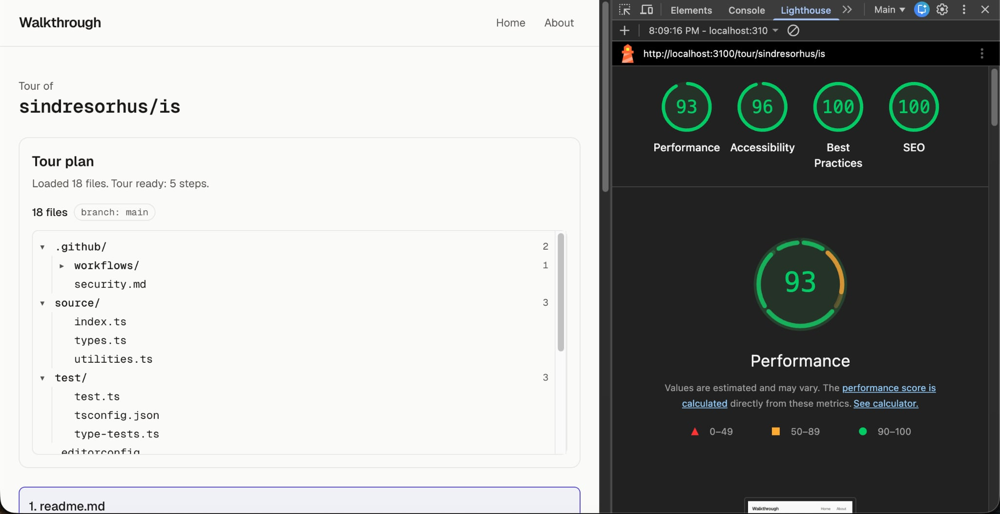
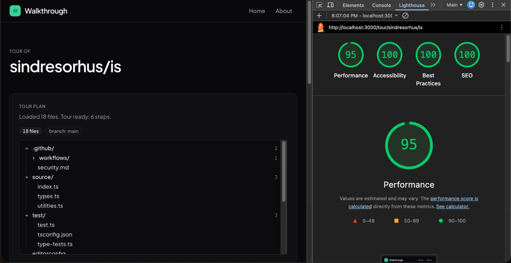
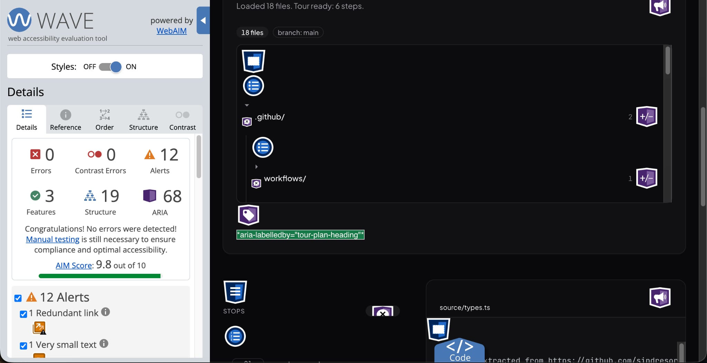
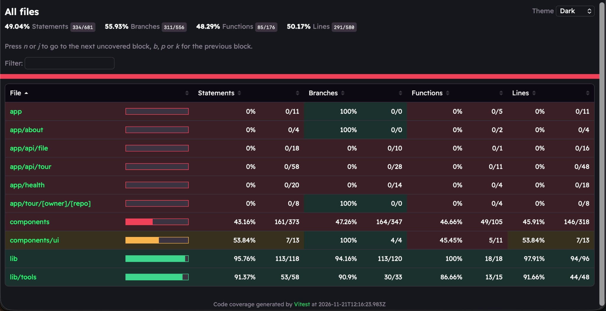

# Audit report

Performance, accessibility and test audit of Walkthrough, run on 2026-11-21 on branch `feat/capstone-final`.

## Method

- Lighthouse 13.6.0, mobile preset, against a production build (`next build && next start`). CLI passes ran in headless Chrome on port 3100; the final screenshots came from Chrome DevTools in Incognito.
- Pages: `/` and `/tour/sindresorhus/is`. The tour page calls the real Groq model, so tour LCP and Speed Index vary from run to run with model latency.
- **Before**: `feat/capstone-final` with `feat/error-states` merged (commit `6946ca7`), before any audit fixes.
- **After**: the current branch (dark theme and home redesign included).
- The tour scores in the first table are from Chrome DevTools Lighthouse runs (mobile, Incognito, `npm start`), matching the screenshots. The metrics table is from the earlier CLI runs of the same builds.

## Lighthouse: before → after

| Page | Performance | Accessibility | Best practices | SEO |
| --- | --- | --- | --- | --- |
| `/` | 100 → 100 | 100 → 100 | 100 → 100 | 100 → 100 |
| `/tour/sindresorhus/is` | 93 → 95 | 96 → 100 | 100 → 100 | 100 → 100 |

| Page | FCP | LCP | TBT | CLS | Speed Index |
| --- | --- | --- | --- | --- | --- |
| `/` | 0.9 s → 0.8 s | 0.9 s → 0.8 s | 10 ms → 10 ms | 0 → 0 | 0.9 s → 0.8 s |
| tour (CLI runs) | 0.9 s → 0.8 s | 3.0 s → 0.8 s | 20 ms → 10 ms | 0.077 → 0.027 | 3.2 s → 1.5 s |

| Before | After |
| --- | --- |
|  |  |

### Scores across intermediate passes

Each UI change was re-audited. Tour scores only; rows marked DevTools used Chrome DevTools in Incognito, the rest the headless CLI:

| Pass | Performance | Accessibility | Tour LCP |
| --- | --- | --- | --- |
| Before (CLI) | 92 | 96 | 3.0 s |
| Before (DevTools, Incognito, re-run) | 93 | 96 | not recorded |
| Audit fixes | 93 | 100 | 3.0 s |
| Light "exhibition" redesign | 93 | 100 | 3.2 s |
| shadcn/ui components (3 runs) | 90 / 89 / 90 | 100 | 3.6 s |
| Dark theme (CLI) | 100 | 100 | 0.8 s |
| Final check (DevTools, Incognito, 2 valid runs) | 93 / 95 | 100 | not recorded |

Home stayed at 100 in every category in every pass.

## What was fixed and why

| Finding | Cause | Fix |
| --- | --- | --- |
| Tour accessibility 96: low-contrast code tokens | Shiki `github-light` colors (e.g. `#e36209` at 3.34:1) on the code background | Switched to a high-contrast Shiki theme; now `github-dark-high-contrast` (`src/lib/highlight.ts`) |
| Draft tour steps below 4.5:1 (Lighthouse missed it: the audit ends after streaming) | Streaming steps used `opacity-70`, putting muted text at ~3.6:1 | Drafts are marked with a dashed border instead of opacity (`TourSteps.tsx`) |
| Tour CLS 0.077 | The footer started in view and got pushed down as the tour streamed in | Tour page wrapper has `min-h-dvh`, so the footer starts below the fold. CLS 0.027 |
| SEO dropped to 90 when trying per-repo titles | With `cacheComponents`, request-time params made Next stream `<title>` into `<body>` | Kept static metadata on the tour route; About and Health got their own descriptions |
| Tour LCP 3.0 s | The LCP element was the first AI-written step, so LCP waited on Groq | Not fixable in render code. In the dark theme the larger `<h1>` became the LCP element (0.8 s); this could flip back if a step caption ever outgrows the heading |
| shadcn `dark:` classes followed the OS setting | Tailwind's default `dark:` variant uses `prefers-color-scheme` | `globals.css` binds `dark:` to the `.dark` class, set once on `<html>` |

Left as is, with reasons:

- **Unused JavaScript**: 54 KiB on home and 140 KiB on tour (was ~94 KiB on tour before), mostly `motion` (BlurText headline) and the AI SDK client needed for streaming. Shiki is not in any client chunk; it only runs in `/api/file`.
- **Render-blocking CSS (~300 ms estimated) and ~14 KiB legacy JS**: Next.js and Tailwind defaults.

## Accessibility

- **WAVE** (WebAIM browser extension, `/tour/sindresorhus/is` on `npm start`, after the tour finished loading): **0 errors, 0 contrast errors**, 12 alerts, 3 features, 19 structural elements, 68 ARIA attributes, AIM score 9.8 / 10. Alerts are items to review by hand, not failures. The visible ones include a redundant link (most likely the header logo and **Home**, which both link to `/`) and very small text.
- **Automated checks**: every component test runs axe-core through `expectNoAxeViolations()` (`src/test/axe.ts`) and asserts zero violations. That covers RepoForm, FileTree, TourSteps, CodePanel and TourPlanner. The `color-contrast` rule is off in those tests because jsdom can't compute colors; Lighthouse and the manual checks below cover contrast.
- **Contrast**: every dark-theme text color was checked on the background, card and muted surfaces. The lowest text pair is faint on muted at 4.97:1; input borders are at least 3.52:1. All `github-dark-high-contrast` token colors pass on the code panel, except one "invalid token" background swatch that is rarely used.
- **Keyboard**:
  - All controls are native links, buttons and inputs, with a `focus-visible` outline (as is the file tree's scroll area).
  - File tree folders open and close from the keyboard, with `aria-expanded` (tested).
  - The selected step and file are marked with `aria-current` (tested).
  - A **Stop generating** button is reachable while the tour streams. Stopping moves focus to the Retry button so focus never drops to `<body>` (tested).
  - Form errors move focus back to the field, and the submit button is never disabled (tested).
- **Screen readers**:
  - Tour progress is announced through one `aria-live="polite"` status line ("Tour ready: N steps"), not token by token.
  - Form errors use an always-mounted live region linked to the field with `aria-describedby`.
  - The BlurText headline keeps its full text in a screen-reader-only span.
- **Reduced motion**: every CSS animation (fade-in, step rule, skeleton pulse) uses `motion-safe:`. BlurText is wrapped in `MotionConfig reducedMotion="user"`, so it doesn't animate when the user asks for less motion.

## Tests and coverage

`npm test`: **191 tests in 13 files, all passing.**

- Library tests (Node): URL parsing, schemas, error messages, GitHub errors, highlighting, rate limiter, sabotage gate, and both tools. Validation tests are table-driven and assert exact error strings.
- Component tests (jsdom + axe-core): RepoForm, FileTree, TourSteps, CodePanel, TourPlanner (with `useChat` mocked and `fetch` stubbed).

`npm run test:coverage` (V8, all of `src/` except tests):

| Scope | Statements | Branches | Functions | Lines |
| --- | --- | --- | --- | --- |
| **All files** | 49.04% | 55.93% | 48.29% | 50.17% |
| `src/lib` | 95.76% | 94.16% | 100% | 97.91% |
| `src/lib/tools` | 91.37% | 90.90% | 86.66% | 91.66% |
| `src/components` | 43.16% | 47.26% | 46.66% | 45.91% |
| `src/components/ui` | 53.84% | 100% | 45.45% | 53.84% |
| `src/app` (pages and routes) | 0% | n/a | 0% | 0% |

The overall number is low because pages, API routes and some components have no tests. The logic they call (validation, error mapping, rate limiting, tools) lives in `src/lib`, which is above 90%. The tested components (CodePanel, FileTree, RepoForm, TourPlanner, TourSteps) are each at 98–100% lines.

## Known limits

- **No route or page tests.** `/api/tour`, `/api/file` and the pages are at 0% coverage. The size cap, body validation, rate limit and Retry-After behaviour were checked by hand against `next start`: an 11 KB body gave 413, a 60-character owner and a 1,100-character path gave 400, the 11th tour request from one IP gave 429 with `retry-after: 600` while another IP was still allowed, and the 61st file request gave 429.
- **Untested components**: BlurText, ExampleTour, Header, Footer and RouteError. They are static or presentational.
- **`planTour` execute path** is at 60% lines: the tool wrapper isn't called directly in tests; its filtering logic (`keepKnownPaths`) is.
- **Rate limits are in memory, per instance**: they reset on cold start and aren't shared between serverless instances.
- **Tour LCP depends on layout**: it is fast only because the heading is the largest element. If a step caption grows larger, LCP will follow Groq latency again (3–3.6 s in earlier passes).
- **Lighthouse runs are single samples**, except the shadcn/ui and final DevTools passes. Tour Performance varies with model latency: the same build scored 100 in the CLI and 93–95 in DevTools.
- **Repeated audits hit the app's own rate limit**: each Lighthouse run starts a tour, so more than 10 runs in 10 minutes get a 429 and a lower score. Restart `npm start` to reset the in-memory counter. Runs with Chrome extensions enabled also score lower (58 in one run), so audit in Incognito.
- **Contrast in tests**: axe-core can't check contrast in jsdom; contrast is only checked by Lighthouse and by hand.
